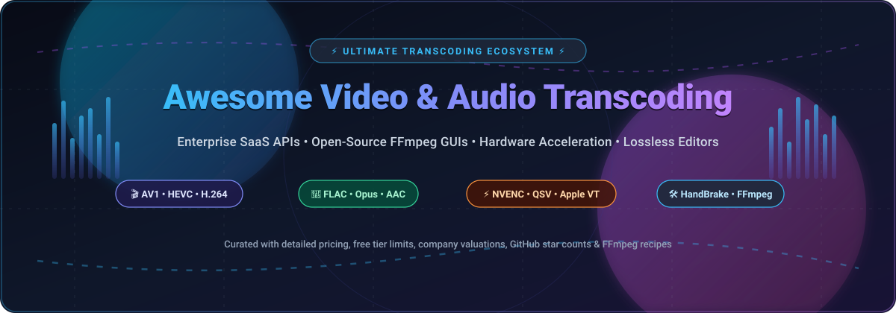

<div align="center">

<a href="https://github.com/ishandutta2007/Awesome-Video-Audio-Transcoding">
  
</a>

# 🎬 Awesome Video &amp; Audio Transcoding 🎵

<a href="https://github.com/ishandutta2007/Awesome-Awesome-Awesome"></a><a href="https://discord.gg/jc4xtF58Ve"></a>
<a href="https://github.com/ishandutta2007/Awesome-Video-Audio-Transcoding/stargazers"></a>
<a href="https://github.com/ishandutta2007/Awesome-Video-Audio-Transcoding/network/members"></a>
<a href="https://github.com/ishandutta2007/Awesome-Video-Audio-Transcoding/blob/main/LICENSE"></a>
<a href="https://github.com/ishandutta2007/Awesome-Video-Audio-Transcoding/pulls"></a>
<a href="https://github.com/ishandutta2007"></a>

<p align="center">
  <strong>A curated index of top-tier SaaS platforms, developer APIs, and open-source GitHub projects for Video &amp; Audio Transcoding.</strong><br/>
  <em>Featuring hardware-accelerated encoding (NVENC, QuickSync, Apple Silicon VideoToolbox), distributed cluster transcode engines, lossless editors, and batch FFmpeg GUIs.</em>
</p>

---

</div>

## 📑 Table of Contents
- [🌐 Sector Overview &amp; Market Dynamics](#-sector-overview--market-dynamics)
- [🏢 SaaS &amp; Hosted Cloud Platforms](#-saas--hosted-cloud-platforms)
- [💻 Open-Source GitHub Projects](#-open-source-github-projects)
- [📊 Feature &amp; Capability Matrix](#-feature--capability-matrix)
- [⚡ Quick Reference: Essential FFmpeg Transcoding Recipes](#-quick-reference-essential-ffmpeg-transcoding-recipes)
- [❓ Frequently Asked Questions (FAQ)](#-frequently-asked-questions-faq)
- [🤝 How to Contribute](#-how-to-contribute)
- [💖 Support](#-support)
- [📈 Star History](#star-history)
- [📜 Disclaimer &amp; License](#-disclaimer--license)

---

## 🌐 Sector Overview &amp; Market Dynamics

The global video and audio transcoding market was estimated at **$1.85 Billion in 2024** and is projected to expand to **$5.2 Billion by 2032**, registering a compound annual growth rate (**CAGR) of ~13.8%**. This rapid acceleration is propelled by surging demand for multi-device OTT streaming, 4K/8K UHD high-bitrate delivery, next-generation royalty-free codecs like **AV1**, short-form video feeds, and edge media processing.

The sector demonstrates a **moderately fragmented, bifurcated structure** rather than a single winner-take-all monopoly:
- **Cloud Hyperscalers &amp; Infrastructure Titans** (e.g., AWS Elemental, Apple, Adobe) capture large-scale broadcast pipelines and creative studio post-production suites.
- **Developer-First Media APIs** (e.g., Cloudinary, Mux, Bitmovin) capture dynamic web, mobile, and live VOD applications requiring programmatic, on-the-fly transformations.
- **The Open-Source Foundation** (anchored universally by **FFmpeg**) commands the desktop, consumer, and self-hosted universe, ensuring that open standards persist and preventing full vendor lock-in across the video engineering industry.

---

## 🏢 SaaS &amp; Hosted Cloud Platforms

The table below lists the industry's premier commercial and cloud video/audio transcoding solutions. It is **sorted descending by company size** (market capitalization / valuation &amp; annual revenue).

| 🏢 SaaS Platform | 📊 Company Valuation / Revenue | 💰 Starting Tier Pricing | 🎁 Free Tier / Trial Limits | 🎯 Core Focus &amp; Key Capabilities |
| :--- | :--- | :--- | :--- | :--- |
| **[Apple Compressor](https://www.apple.com/final-cut-pro/compressor/)** | **~$3.5 Trillion** Market Cap<br/>_~$391B Annual Revenue_ | **$49.99** one-time purchase on Mac App Store | **90-Day Free Trial** (bundled with full Final Cut Pro evaluation package) or 14-day standard Mac App Store return window | Native macOS / Apple Silicon hardware acceleration, ProRes / ProRes RAW / HEVC encoding, and distributed network encoding across Macs. |
| **[AWS Elemental MediaConvert](https://aws.amazon.com/mediaconvert/)** | **~$2.3 Trillion** Market Cap (Amazon)<br/>_~$105B+ AWS Revenue_ | **$0.0075 / minute** for Basic Tier (SD/HD 30fps); **$0.015 / minute** for Professional Tier | **20 minutes / month** of Basic Tier transcoding free for the first **12 months** under AWS Free Tier | Broadcast-grade cloud transcoding at cloud scale, multi-codec packaging (CMAF, HLS, DASH), Dolby Vision HDR, and automated bitrate ladder generation. |
| **[Adobe Media Encoder](https://www.adobe.com/products/media-encoder.html)** | **~$220 Billion** Market Cap<br/>_~$21.4B Annual Revenue_ | **$22.99 / month** (single-app Premiere Pro subscription) or **$59.99 / month** (Creative Cloud All Apps) | **7-Day Free Trial** with full feature access, unwatermarked encoding, and Adobe Creative Cloud storage sync | Seamless round-trip proxy creation and batch rendering for Adobe Premiere Pro and After Effects, with comprehensive broadcast preset profiles. |
| **[Cloudinary](https://cloudinary.com/)** | **~$2.0 Billion** Valuation<br/>_~$150M+ ARR_ | **$89.00 / month** (Plus plan, providing 225 monthly credits) | **Free Forever Plan** with **25 credits / month** (~25,000 video transformations or 25 GB net managed bandwidth and storage) | Real-time dynamic URL-based transcoding, automated format selection (`f_auto`), smart perceptual quality compression (`q_auto`), and global multi-CDN delivery. |
| **[Wondershare UniConverter](https://videoconverter.wondershare.com/)** | **~$1.2 Billion** Market Cap (SZSE: 300624)<br/>_~$210M Annual Revenue_ | **$39.99 / quarter**, **$59.99 / year**, or **$79.99** perpetual lifetime license | **Free Trial Version** allowing conversion of 1/3 duration of any file (max 5 minutes) and 720p maximum resolution | Consumer-oriented all-in-one desktop converter supporting 1,000+ formats, DVD burning, keyframe cutting, and high-speed GPU acceleration. |
| **[Mux Video](https://www.mux.com/)** | **~$1.05 Billion** Valuation<br/>_~$50M ARR_ | **$0.005 / minute** for Basic video encoding; **$0.0013 / minute** for video streaming | **$100 Free Credit** upon account sign-up (covers up to 20,000 minutes of basic encoding, zero expiration during evaluation) | Developer-centric API-first video processing, instant just-in-time HLS/DASH packaging, live-stream ingestion, and automatic thumbnail extraction. |
| **[Bitmovin Video Encoding](https://bitmovin.com/video-encoding/)** | **~$250 Million** Valuation<br/>_~$35M ARR_ | **$0.0019 / output minute** (Pay-As-You-Go) or **$199 / month** (Team plan with dedicated support) | **30-Day Free Trial** including **10,000 free encoding minutes** ($500 value) across all supported codecs | Split-and-stitch cloud architecture offering up to 100x real-time encoding speeds, cutting-edge AV1 / VVC codec support, and AI-driven Per-Title Bitrate Optimization. |

---

## 💻 Open-Source GitHub Projects

The leading open-source transcoders, GUIs, distributed cluster systems, and media engines, **strictly sorted in descending order of GitHub Stars_Count**.

### 1. [FFmpeg](https://ffmpeg.org/) [](https://github.com/FFmpeg/FFmpeg/stargazers)
- **Repository**: [FFmpeg/FFmpeg](https://github.com/FFmpeg/FFmpeg)
- **License**: LGPL-2.1+ / GPL-2.0+
- **Overview**: The undisputed universal foundation of modern digital media. A complete, hyper-optimized cross-platform CLI solution to record, convert, filter, mux, demux, and stream virtually every video and audio format known to humanity. Almost every modern desktop converter, streaming server, and browser engine interfaces with `libavcodec` and `libavformat` under the hood.
- **Key Features**: Hardware acceleration pipelines (NVIDIA NVENC/NVDEC, Intel QuickSync, Apple VideoToolbox, VAAPI, AMD AMF), complex filtergraphs, HDR tone mapping, AI super-resolution integrations, and native support for AV1, HEVC, H.264, VP9, ProRes, FLAC, and Opus.

---

### 2. [LosslessCut](https://mifi.no/lossless-cut/) [](https://github.com/mifi/lossless-cut/stargazers)
- **Repository**: [mifi/lossless-cut](https://github.com/mifi/lossless-cut)
- **License**: GPL-2.0
- **Overview**: The ultimate Swiss Army knife for extremely fast, lossless trimming, splitting, and merging of video and audio files without re-encoding. By operating strictly at codec keyframe boundaries, large multi-gigabyte camera or drone files are sliced in seconds without generation loss.
- **Key Features**: Instant lossless export, track extraction/replacement, subtitle preservation, batch segment cutting, frame capture, and cross-platform desktop UI (Electron + FFmpeg).

---

### 3. [HandBrake](https://handbrake.fr/) [](https://github.com/HandBrake/HandBrake/stargazers)
- **Repository**: [HandBrake/HandBrake](https://github.com/HandBrake/HandBrake)
- **License**: GPL-2.0
- **Overview**: The gold standard in open-source desktop video transcoders. HandBrake wraps high-level FFmpeg and x264/x265/SVT-AV1 encoders behind an accessible yet powerful interface, packed with well-tuned presets for social media, mobile devices, home theaters, and web delivery.
- **Key Features**: Extensive hardware-accelerated encoding (NVENC, QuickSync, Apple VideoToolbox, AMD VCN), batch queue management, chapter markers, soft subtitles, video filters (deinterlace, denoise, decomb), and native AV1 10-bit output.

---

### 4. [Tdarr](https://tdarr.io/) [](https://github.com/HaveAGitGat/Tdarr/stargazers)
- **Repository**: [HaveAGitGat/Tdarr](https://github.com/HaveAGitGat/Tdarr)
- **License**: Open Source Core / Freeware
- **Overview**: A conditional media transcoding automation platform designed for massive local or networked media libraries. Operates on a distributed client/server architecture where worker nodes on multiple machines collaborate to transcode, re-mux, and clean library files automatically.
- **Key Features**: Distributed cluster nodes across LAN, modular plugin pipeline, GPU-accelerated transcoding (NVIDIA, Intel, AMD, Apple Silicon), automated library space savings tracker, and customizable audio/video filters.

---

### 5. [rav1e](https://github.com/xiph/rav1e) [](https://github.com/xiph/rav1e/stargazers)
- **Repository**: [xiph/rav1e](https://github.com/xiph/rav1e)
- **License**: BSD-2-Clause
- **Overview**: The fastest, safest pure-Rust AV1 video encoder engineered by Xiph.Org and the Mozilla foundation. Designed to provide a memory-safe, thread-safe, and highly predictable encoding engine for modern next-generation media workflows.
- **Key Features**: Rust memory safety guarantees, assembly optimizations (AVX2, AVX-512, ARM Neon), clean C-API bindings, and native support across streaming media frameworks.

---

### 6. [GPAC (MP4Box)](https://gpac.io/) [](https://github.com/gpac/gpac/stargazers)
- **Repository**: [gpac/gpac](https://github.com/gpac/gpac)
- **License**: LGPL-2.1
- **Overview**: An open-source multimedia framework specializing in packaging, streaming, and multiplexing digital content. Best known for `MP4Box`, the reference tool for MP4 container manipulation, MPEG-DASH segmentation, and CMAF generation.
- **Key Features**: ISO Base Media File Format (ISOBMFF) inspection, MPEG-DASH / HLS packaging, DRM encryption signaling, subtitle injection, and high-performance streaming pipelines.

---

### 7. [StaxRip](https://staxrip.info/) [](https://github.com/staxrip/staxrip/stargazers)
- **Repository**: [staxrip/staxrip](https://github.com/staxrip/staxrip)
- **License**: MIT
- **Overview**: A power-user video encoding GUI for Windows. It acts as an orchestrator uniting AviSynth and VapourSynth frame servers with leading CLI encoders such as x264, x265, SVT-AV1, and hardware encoders.
- **Key Features**: Deep script-driven video filtering, HDR metadata preservation, audio multichannel upmixing/downmixing, batch processing, and modular third-party tool integration.

---

### 8. [Shutter Encoder](https://www.shutterencoder.com/) [](https://github.com/paulpacifico/shutter-encoder/stargazers)
- **Repository**: [paulpacifico/shutter-encoder](https://github.com/paulpacifico/shutter-encoder)
- **License**: GPL-3.0
- **Overview**: A Swiss Army knife converter built for video editors, broadcasters, and post-production professionals. Built directly on top of FFmpeg, it exposes complex video transformations as intuitive one-click actions.
- **Key Features**: "Cut without re-encoding", audio track replacement, burn-in timecodes and subtitles, broadcast codecs (Apple ProRes, Avid DNxHD/HR, XAVC), deinterlacing, and AV1 NVENC hardware encoding.

---

### 9. [Unmanic](https://unmanic.app/) [](https://github.com/Unmanic/unmanic/stargazers)
- **Repository**: [Unmanic/unmanic](https://github.com/Unmanic/unmanic)
- **License**: GPL-3.0
- **Overview**: An open-source background library optimizer and video/audio transcoder. It monitors directories for incoming media files and automatically triggers transcoding queues to normalize formats, reduce disk footprints, and conform codecs.
- **Key Features**: Modular plugin architecture, automated folder watcher, multi-worker concurrency, hardware acceleration support, and a sleek web dashboard.

---

### 10. [fre:ac](https://freac.org/) [](https://github.com/enzo1982/freac/stargazers)
- **Repository**: [enzo1982/freac](https://github.com/enzo1982/freac)
- **License**: GPL-2.0
- **Overview**: The premier free and open-source audio converter and CD ripper for Windows, Linux, and macOS. Excels at high-speed multithreaded audio format conversion, metadata tagging, and lossless CD preservation.
- **Key Features**: Full support for MP3, MP4/AAC, Opus, FLAC, Ogg Vorbis, and Apple Lossless (ALAC), integrated CDDB/freedb metadata query, cue sheet splitting, and translation into 40+ languages.

---

### 11. [FastFlix](https://fastflix.org/) [](https://github.com/cdgriffith/FastFlix/stargazers)
- **Repository**: [cdgriffith/FastFlix](https://github.com/cdgriffith/FastFlix)
- **License**: MIT
- **Overview**: A friendly yet advanced GUI for FFmpeg, Rigaya encoders, and SVT-AV1. Built specifically with modern 10-bit HDR encoding workflows in mind, retaining HDR10, HDR10+, and Dolby Vision metadata.
- **Key Features**: Supports SVT-AV1, libvpx, x265, and hardware encoders (NVENC, QSV, VCE); built-in bitrate calculator; multi-pass encoding; and subtitle/audio extraction.

---

### 12. [NVEnc](https://github.com/rigaya/NVEnc) [](https://github.com/rigaya/NVEnc/stargazers)
- **Repository**: [rigaya/NVEnc](https://github.com/rigaya/NVEnc)
- **License**: MIT
- **Overview**: High-speed standalone GPU encoding application utilizing NVIDIA NVENC hardware. Highly regarded in the video processing community for raw performance and granular control over NVIDIA hardware encoder pipelines.
- **Key Features**: Support for H.264, HEVC, and AV1 hardware encoding; CUDA video filtering (denoise, deinterlace, resize); direct VapourSynth and AviSynth script feeding; and ultra-low latency profiles.

---

### 13. [BMF (Babit Multimedia Framework)](https://babitmf.github.io/) [](https://github.com/BabitMF/bmf/stargazers)
- **Repository**: [BabitMF/bmf](https://github.com/BabitMF/bmf)
- **License**: Apache-2.0
- **Overview**: ByteDance's industrial multimedia framework engineered to process billions of videos daily at hyperscale. Decouples video decoding, AI inference, and GPU transcoding into high-performance graph pipelines.
- **Key Features**: Multi-language APIs (Python, Go, C++), seamless GPU memory sharing across FFmpeg, PyTorch, OpenCV, TensorRT, and distributed transcode worker orchestrations.

---

### 14. [Avidemux](http://avidemux.sourceforge.net/) [](https://github.com/mean00/avidemux2/stargazers)
- **Repository**: [mean00/avidemux2](https://github.com/mean00/avidemux2)
- **License**: GPL-2.0
- **Overview**: A classic, lightweight video editor and transcoder designed for quick cuts, basic filtering, and format encoding. An ideal minimalist tool when launching a full timeline NLE is overkill.
- **Key Features**: Keyframe cutting, deinterlacing, audio filter normalization, project job queues, and cross-platform native builds for Linux, Windows, and macOS.

---

## 📊 Feature &amp; Capability Matrix

| Tool / Framework | Type | Primary Interface | Primary Codecs | Hardware Acceleration | Lossless Slicing | Distributed Clustering |
| :--- | :--- | :--- | :--- | :--- | :---: | :---: |
| **FFmpeg** | Open-Source | CLI / C Library | AV1, HEVC, H.264, ProRes, Opus, FLAC | NVENC, QSV, VideoToolbox, VAAPI, AMF | ⚡ Yes | 🔌 Via Scripts |
| **HandBrake** | Open-Source | Desktop GUI &amp; CLI | AV1, HEVC, H.264, VP9, MP4, MKV | NVENC, QSV, VideoToolbox, VCN | ❌ No | ❌ No |
| **LosslessCut** | Open-Source | Desktop GUI | All FFmpeg-compatible streams | GPU playback decoding | ⚡ Yes (Instant) | ❌ No |
| **Tdarr** | Open-Source Core | Web Dashboard &amp; CLI | Any via FFmpeg &amp; HandBrake | NVENC, QSV, VideoToolbox, VAAPI | ⚡ Yes | ⚡ Yes (Native LAN) |
| **Shutter Encoder** | Open-Source | Desktop GUI | AV1, HEVC, H.264, ProRes, DNxHD | NVENC, QuickSync, Apple VideoToolbox | ⚡ Yes | ❌ No |
| **fre:ac** | Open-Source | Desktop GUI &amp; CLI | FLAC, MP3, Opus, AAC, Ogg, ALAC | Multi-core CPU threading | ⚡ Yes (Audio) | ❌ No |
| **FastFlix** | Open-Source | Desktop GUI | AV1, HEVC, H.264, VP9 | NVENC, QSV, VCE | ❌ No | ❌ No |
| **BMF** | Open-Source | Python / C++ / Go APIs | Universal via FFmpeg + AI TensorRT | Full GPU TensorRT / CUDA pipeline | ⚡ Yes | ⚡ Yes (Cloud scale) |
| **AWS MediaConvert** | Hosted SaaS | REST API / AWS Console | Broadcast MPEG-2, AVC, HEVC, AV1 | AWS Enterprise cloud infrastructure | ⚡ Yes | ⚡ Yes (AWS Elastic) |
| **Bitmovin** | Hosted SaaS | REST API / Dashboard | AV1, VVC, HEVC, H.264, VP9 | Cloud split-and-stitch architecture | ⚡ Yes | ⚡ Yes (Multi-cloud) |
| **Cloudinary** | Hosted SaaS | REST API / URL transforms | AV1, HEVC, H.264, WebM, MP3 | Edge-accelerated media cloud | ⚡ Yes | ⚡ Yes (Serverless) |

---

## ⚡ Quick Reference: Essential FFmpeg Transcoding Recipes

Save time with these battle-tested, high-performance command-line recipes:

### 1. High-Efficiency AV1 Video Encoding (SVT-AV1)
```bash
ffmpeg -i input.mov -c:v libsvtav1 -crf 26 -preset 6 -g 240 -pix_fmt yuv420p10le \
       -c:a libopus -b:a 128k output.mp4
```

### 2. High-Quality H.265 / HEVC with Audio Normalization
```bash
ffmpeg -i input.mkv -c:v libx265 -crf 22 -preset medium -tag:v hvc1 \
       -c:a aac -b:a 192k -af "loudnorm=I=-16:TP=-1.5:LRA=11" output.mp4
```

### 3. Ultra-Fast GPU Transcode with NVIDIA NVENC (H.264 / HEVC)
```bash
ffmpeg -hwaccel cuda -i input.mp4 -c:v hevc_nvenc -preset p5 -rc vbr \
       -cq 24 -b:v 0 -c:a copy output_nvenc.mp4
```

### 4. Lossless Video Trim Without Re-Encoding (Lightning Fast)
```bash
ffmpeg -ss 00:01:30 -to 00:04:15 -i input.mp4 -c copy -avoid_negative_ts make_zero trimmed.mp4
```

### 5. Multi-Threaded Audio Conversion: FLAC to High-Bitrate Opus
```bash
ffmpeg -i input.flac -c:a libopus -b:a 160k -vbr on -compression_level 10 output.opus
```

### 6. Extract Audio Stream Losslessly from Video Container
```bash
ffmpeg -i movie.mkv -vn -c:a copy extracted_audio.aac
```

---

## ❓ Frequently Asked Questions (FAQ)

### What is the difference between Transcoding and Re-muxing?
- **Re-muxing** (container swapping) takes the underlying audio and video streams and places them into a different wrapper (e.g. MKV to MP4) without re-encoding data. It takes seconds and causes **zero generation loss**.
- **Transcoding** decodes the compressed video/audio bits into raw uncompressed pixels/samples and re-compresses them using another codec or target bitrate. It is CPU/GPU intensive and adjusts quality and file size.

### Which video codec should I choose in 2026?
- **AV1**: Best compression efficiency and open royalty-free licensing. Ideal for web, mobile apps, and YouTube distribution.
- **HEVC (H.265)**: High compression efficiency with universal hardware playback on 4K TVs, Apple devices, and smartphones.
- **H.264 (AVC)**: Maximum backwards compatibility for legacy devices, older browsers, and enterprise players.
- **Apple ProRes / Avid DNxHR**: Visually lossless intra-frame codecs intended for editing timelines and intermediate color grading workflows.

### Should I choose CPU (software) or GPU (hardware) encoding?
- **Software (CPU)** encoders (`libx264`, `libx265`, `libsvtav1`) deliver the highest quality-per-bitrate ratio and smallest final file sizes, but require heavy CPU compute time.
- **Hardware (GPU/ASIC)** encoders (NVIDIA NVENC, Intel QuickSync, Apple VideoToolbox) transcode significantly faster (often 5x–20x real-time), making them the top choice for live streams, fast batch processing, and proxy generation.

---

## 🤝 How to Contribute

Contributions to expand and update this guide are welcome!

1. 🍴 **Fork** this repository.
2. 🌿 **Create a new branch**: `git checkout -b feature/new-tool-entry`
3. 📝 **Add or update entries** in `README.md` following the existing format.
4. 🔍 Ensure links are active and pricing/Stars_Counts are accurate.
5. 🚀 **Submit a Pull Request** with a descriptive summary of your additions.

---

## 💖 Support

A heartfelt **thank you** to everyone exploring, using, and contributing to the **Awesome Video & Audio Transcoding** ecosystem! Maintaining this curated directory with up-to-date pricing, benchmarks, and codec developments takes ongoing dedication.

If you find this repository helpful, please consider supporting it:
- ⭐ **Star this repository** on GitHub to boost visibility.
- 🍴 **Fork & Contribute** tools, recipes, and updates.
- 📢 **Share** with colleagues, developers, and media engineers.
- ☕ **Buy Me a Coffee / Sponsor**: Support continued open-source curation and development via the [GitHub Sponsors Dashboard](https://github.com/sponsors/ishandutta2007).

<p align="center">
  <a href="https://github.com/sponsors/ishandutta2007">
    
  </a>
  <a href="https://github.com/sponsors/ishandutta2007">
    
  </a>
</p>

---

##  Star History

[](https://star-history.dera.page/#ishandutta2007/Awesome-Video-Audio-Transcoding&type=date&legend=top-left)

---

## 📜 Disclaimer &amp; License

- This is a community-maintained index provided for educational and architectural reference. Product trademarks, logos, and service names belong to their respective corporate entities.
- Distributed under the [MIT License](https://github.com/ishandutta2007/Awesome-Video-Audio-Transcoding/blob/main/LICENSE).
